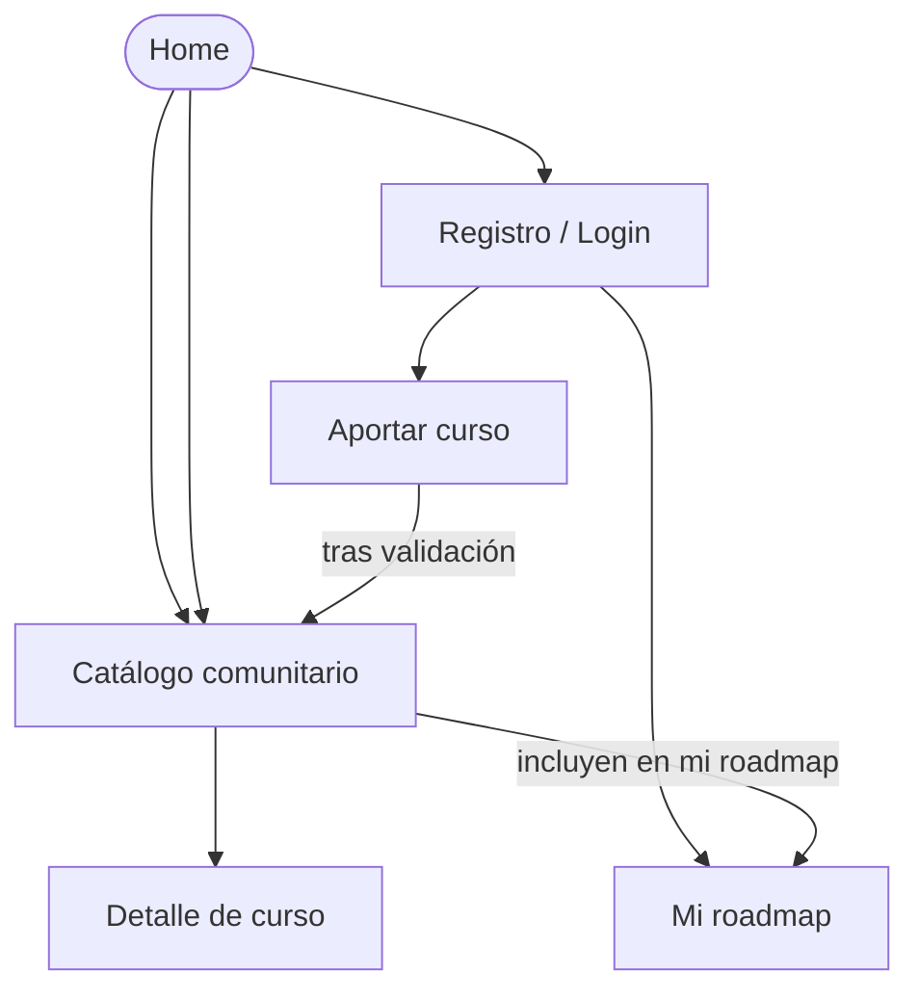

# APPFlow — Mapa del sitio y flujos de usuario — Aprendamos

> **Qué es:** el esqueleto de navegación. Sitemap (todas las pantallas y sus rutas), ficha por
> pantalla y flujos de usuario extremo a extremo. Es el puente entre el PRD (qué quiere el usuario)
> y el BackendSchema (qué API lo sostiene).
> **Cuándo está bien:** se puede recorrer el producto entero en papel antes de escribir una línea
> de React; cada pantalla sabe qué API consume, y esas APIs existen en el BackendSchema;
> no hay ninguna pantalla "colgada" sin ruta ni ningún flujo sin pantallas.

## 1. Sitemap

## 2. Rutas

| Ruta | Pantalla | Requiere login | Notas |
|------|----------|----------------|-------|
| `/` | Home | no | Página de inicio y acceso al catálogo. |
| `/catalogo` | Catálogo comunitario (paginado) | no | Búsqueda y filtros por categoría. |
| `/catalogo/:id` | Detalle de curso | no | Información del curso y opción de agregarlo al roadmap. |
| `/registro` | Registro | no | Crear una cuenta de usuario. |
| `/login` | Iniciar sesión | no | Autenticación de usuario. |
| `/recuperar-password` | Recuperar contraseña | no | Solicitar el restablecimiento de contraseña. |
| `/restablecer-password/:token` | Establecer nueva contraseña | no | Restablecer la contraseña mediante un token. |
| `/roadmap` | Mi roadmap | sí | Redirigir a `/login` si no hay sesión. |
| `/aportar` | Formulario de aporte | sí | Enviar un curso para su validación. |
| `/aportar/:id/estado` | Estado de mi aporte | sí | Consultar el estado de la contribución propia. |
| `/validar` | Panel de validación | sí (rol administrador) | Revisar y aprobar o rechazar aportes. |

## 3. Fichas de pantalla

> Una por cada pantalla del sitemap.

### Pantalla: Catálogo comunitario (`/catalogo`)

- **Objetivo del usuario:** descubrir cursos gratuitos disponibles en el catálogo comunitario.
- **Componentes (de la UX-UI):** header, filtros/búsqueda, grid de cards, paginador, empty state, skeleton.
- **Estados:** `loading` (skeleton) · `ok` · `empty` (sin resultados) · `error` (retry).
- **APIs que consume:** `GET /api/v1/cursos?page=…&page_size=…&categoria=…&q=…` → ver BackendSchema §3.2.
- **Navegación:** desde Home/menú; hacia Detalle de curso; opción de agregar el curso al roadmap si el usuario tiene sesión iniciada.

### Pantalla: Detalle de curso (`/catalogo/:id`)

- **Objetivo del usuario:** consultar la información de un curso y decidir si quiere incorporarlo a su roadmap.
- **Componentes (de la UX-UI):** header, información del curso, datos de la organización y docentes, indicadores de cuestionarios/examen/certificado/aval, botón para agregar al roadmap.
- **Estados:** `loading` (skeleton) · `ok` · `error` (retry) · `not-found` (curso inexistente).
- **APIs que consume:** `GET /api/v1/cursos/{id}` → ver BackendSchema §3.2. `POST /api/v1/roadmap/items` para agregar el curso → ver BackendSchema §3.4.
- **Navegación:** desde el catálogo; hacia Mi roadmap al agregar un curso; hacia Iniciar sesión si intenta agregar un curso sin tener sesión iniciada.

### Pantalla: Aportar curso (`/aportar`)

- **Objetivo del usuario:** proponer un curso gratuito para incorporarlo al catálogo comunitario.
- **Componentes (de la UX-UI):** header, formulario, campos obligatorios, selector de categoría, indicadores de características del curso, declaración de haber realizado el curso y botón de envío.
- **Estados:** `idle` · `submitting` · `success` · `validation-error` · `error` (retry).
- **APIs que consume:** `POST /api/v1/aportes` → ver BackendSchema §3.3.
- **Navegación:** desde el menú/header; hacia Estado de mi aporte después de enviar correctamente el formulario; permanece en la pantalla si hay errores de validación.

### Pantalla: Mi roadmap (`/roadmap`)

- **Objetivo del usuario:** organizar y consultar los cursos que desea realizar, respetando el orden elegido.
- **Componentes (de la UX-UI):** header, lista ordenada de cursos, cards de curso, controles para agregar o quitar cursos y estado vacío.
- **Estados:** `loading` (skeleton) · `ok` · `empty` (sin cursos) · `error` (retry).
- **APIs que consume:** `GET /api/v1/roadmap` para consultar el roadmap; `POST /api/v1/roadmap/items` para agregar un curso; `DELETE /api/v1/roadmap/items/{id}` para quitarlo → ver BackendSchema §3.4.
- **Navegación:** desde el menú o después de agregar un curso; hacia el detalle de cada curso; hacia el catálogo para descubrir otros cursos.

### Pantalla: Home (`/`)

- **Objetivo del usuario:** conocer Aprendamos y acceder al catálogo comunitario o a las opciones de autenticación.
- **Componentes (de la UX-UI):** header, presentación del producto, acceso al catálogo y enlaces de registro e inicio de sesión.
- **Estados:** `ok` · `error` si falla la carga de contenido dinámico.
- **APIs que consume:** no requiere una API específica si el contenido de inicio es estático.
- **Navegación:** hacia Catálogo comunitario, Registro e Iniciar sesión.

### Pantalla: Registro (`/registro`)

- **Objetivo del usuario:** crear una cuenta para utilizar las funcionalidades personales de Aprendamos.
- **Componentes (de la UX-UI):** header, formulario de registro, campos de email, contraseña y nombre, mensajes de validación y botón de envío.
- **Estados:** `idle` · `submitting` · `success` · `validation-error` · `error`.
- **APIs que consume:** `POST /api/v1/auth/registro` → ver BackendSchema §3.1.
- **Navegación:** desde Home o Iniciar sesión; después del registro exitoso, hacia Iniciar sesión.

### Pantalla: Iniciar sesión (`/login`)

- **Objetivo del usuario:** autenticarse para acceder a su roadmap y aportar cursos.
- **Componentes (de la UX-UI):** header, formulario de email y contraseña, mensajes de error, botón de inicio de sesión y enlace para recuperar la contraseña.
- **Estados:** `idle` · `submitting` · `success` · `invalid-credentials` · `error` (retry).
- **APIs que consume:** `POST /api/v1/auth/login` → ver BackendSchema §3.1.
- **Navegación:** desde Home o una ruta protegida; hacia Mi roadmap o hacia la ruta original después de iniciar sesión; hacia Recuperar contraseña.

### Pantalla: Recuperar contraseña (`/recuperar-password`)

- **Objetivo del usuario:** solicitar un enlace para restablecer su contraseña.
- **Componentes (de la UX-UI):** formulario de email, mensaje de confirmación y botón para enviar la solicitud.
- **Estados:** `idle` · `submitting` · `success` · `error`.
- **APIs que consume:** pendiente de definir en BackendSchema.
- **Navegación:** desde Iniciar sesión; hacia Establecer nueva contraseña mediante el enlace recibido por el usuario.

### Pantalla: Establecer nueva contraseña (`/restablecer-password/:token`)

- **Objetivo del usuario:** establecer una nueva contraseña utilizando el token de recuperación.
- **Componentes (de la UX-UI):** formulario de nueva contraseña y confirmación, mensajes de validación y botón para guardar.
- **Estados:** `idle` · `submitting` · `success` · `invalid-token` · `error`.
- **APIs que consume:** pendiente de definir en BackendSchema.
- **Navegación:** desde el enlace de recuperación; hacia Iniciar sesión después de restablecer correctamente la contraseña.

### Pantalla: Estado de mi aporte (`/aportar/:id/estado`)

- **Objetivo del usuario:** consultar si su aporte está pendiente de revisión, publicado o rechazado.
- **Componentes (de la UX-UI):** header, información del curso aportado, indicador de estado y, si corresponde, motivo del rechazo.
- **Estados:** `loading` · `ok` · `error` · `not-found` · `forbidden`.
- **APIs que consume:** `GET /api/v1/aportes/{id}` → ver BackendSchema §3.3.
- **Navegación:** desde el formulario después de enviar un aporte; hacia el catálogo si el curso fue publicado; hacia el formulario de aporte si se permite corregir y reenviar un aporte rechazado.

### Pantalla: Panel de validación (`/validar`)

- **Objetivo del usuario:** permitir al administrador revisar las contribuciones y decidir si corresponde aprobarlas o rechazarlas.
- **Componentes (de la UX-UI):** header, listado de aportes pendientes, información del curso, controles para aprobar o rechazar y campo para indicar el motivo del rechazo.
- **Estados:** `loading` · `ok` · `empty` (sin aportes pendientes) · `error` · `forbidden`.
- **APIs que consume:** `POST /api/v1/aportes/{id}/validar` para registrar la decisión → ver BackendSchema §3.3. La API para listar los aportes pendientes y registrar el motivo del rechazo debe definirse o confirmarse en BackendSchema.
- **Navegación:** desde el acceso de administración; hacia la revisión de un aporte y, después de aprobarlo, al catálogo comunitario.

## 4. Flujos de usuario (mínimo 3)

> Pasos numerados de punta a punta, incluyendo validaciones, errores y ramas alternativas.

### Flujo 1 — Aportar un curso al catálogo

1. Usuario logueado presiona "Aportar curso" (menú/header)
2. Llega a `/aportar`; el formulario pide: URL activa, categoría (lista), tema, título, versión, año, docentes, flags (cuestionarios / examen / certificado / aval), y la declaración "yo tomé este curso"
3. Validaciones en línea: [campos obligatorios, formato de URL, duplicado]
4. Submit → `POST /api/v1/aportes` → 201 con estado `en_revision`
5. Toast de confirmación + redirección a "estado de mi aporte"
6. **Rama de error:** validación fallida → mensajes inline, nada se pierde; error de red → toast de error + reintentar

### Flujo 2 — Descubrir un curso y agregarlo a mi roadmap

1. El usuario ingresa a Home y accede al catálogo comunitario en `/catalogo`.
2. Consulta los cursos disponibles, utiliza la búsqueda o filtra por categoría y navega entre páginas.
3. Selecciona un curso y accede a `/catalogo/:id`.
4. La aplicación consulta los datos del curso mediante `GET /api/v1/cursos/{id}`.
5. El usuario selecciona la opción para agregarlo a su roadmap.
6. Si no tiene sesión iniciada, se lo redirige a `/login` y se conserva el destino original para regresar después de autenticarse.
7. Si tiene sesión iniciada, la aplicación envía `POST /api/v1/roadmap/items` con el identificador del curso y el orden correspondiente.
8. Si la operación es exitosa, se confirma la incorporación y se actualiza el roadmap.
9. **Rama de error:** si el curso ya está incluido, se informa la situación; si el curso no existe o no está publicado, se muestra el error correspondiente; si falla la conexión, se permite reintentar.

### Flujo 3 — Validación de un aporte (según tu decisión de producto)

1. El administrador inicia sesión con una cuenta que tiene permisos de validación.
2. Accede a `/validar` y consulta los aportes pendientes de revisión.
3. Selecciona un aporte y revisa la información del curso.
4. Decide aprobarlo o rechazarlo.
5. Si lo aprueba, envía la decisión mediante `POST /api/v1/aportes/{id}/validar` con `"aprobado": true`.
6. Si lo rechaza, indica el motivo del rechazo y envía la decisión. La API debe contemplar el registro de ese motivo.
7. Si la operación es exitosa, se actualiza el estado del aporte. Los cursos aprobados quedan disponibles en el catálogo comunitario.
8. **Rama de error:** si el usuario no tiene permisos, se deniega la operación; si falla la conexión, se informa el error y se permite reintentar; si no quedan aportes pendientes, se muestra un estado vacío.

### Flujo 4 (opcional) — Registro y primeros pasos

1. [...]

## 5. Estados globales de la app

| Situación | Comportamiento |
|-----------|----------------|
| Sin sesión y ruta protegida | Redirigir a `/login` conservando la ruta original para regresar después de autenticarse. |
| Sesión expirada | Informar que la sesión expiró, cerrar la sesión y redirigir a `/login`. |
| Error de red global | Mostrar un mensaje claro y ofrecer reintentar cuando la operación lo permita. |

---

**Referencias:**
- NN/g — Information Architecture vs. Sitemaps: https://www.nngroup.com/articles/information-architecture-sitemaps/
- NN/g — User Journeys vs. User Flows: https://www.nngroup.com/articles/user-journeys-vs-user-flows/
