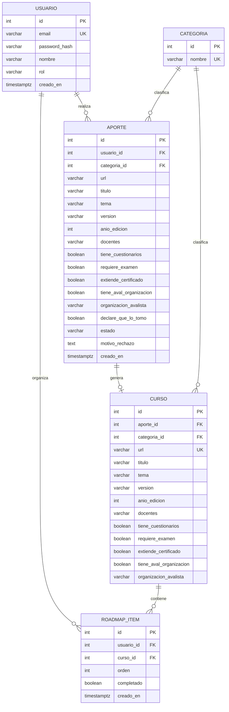
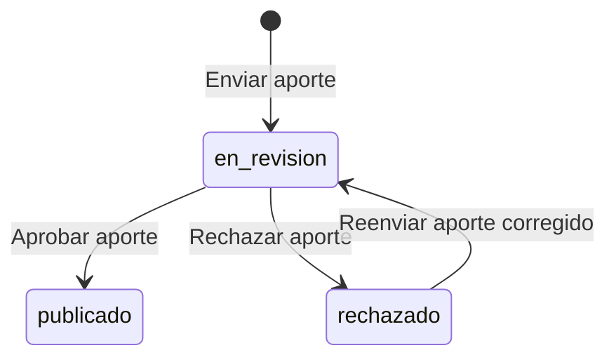

# BackendSchema — Esquema de base de datos y APIs — Aprendamos

> **Qué es:** el contrato del backend: modelo de datos en PostgreSQL + superficie de API REST.
> Es lo que hace posible el TRD y lo que consume el APPFlow.
> **Cuándo está bien:** con este documento se puede crear la base de datos y escribir los tests
> de integración sin tomar decisiones de diseño pendientes; todo endpoint que aparece en el
> APPFlow existe acá con sus respuestas y errores; los estados del curso están modelados.

## 1. Modelo de datos

### 1.1 Diagrama entidad-relación (Mermaid — se renderiza en GitHub)



### 1.2 Tablas (una por entidad)

#### `usuarios`

| Columna | Tipo | Constraints | Notas |
|---------|------|-------------|-------|
| id | serial | PK | Identificador del usuario. |
| email | varchar(255) | UNIQUE NOT NULL | Identificador de login. |
| password_hash | varchar(255) | NOT NULL | Nunca almacenar la contraseña en claro. |
| nombre | varchar(100) | NOT NULL | Nombre del usuario. |
| rol | varchar(20) | NOT NULL, DEFAULT 'usuario', CHECK | Valores permitidos: `usuario`, `admin`. |
| creado_en | timestamptz | NOT NULL DEFAULT now() | Fecha de creación de la cuenta. |

**Índices:**
- Índice único sobre `email`, generado por la restricción `UNIQUE`, para localizar usuarios durante el inicio de sesión.

#### `categorias`

| Columna | Tipo | Constraints | Notas |
|---------|------|-------------|-------|
| id | serial | PK | Identificador de la categoría. |
| nombre | varchar(100) | UNIQUE NOT NULL | Nombre de la categoría. |

**Índices:**
- Índice único sobre `nombre`, generado por la restricción `UNIQUE`, para evitar categorías duplicadas.

#### `cursos`

| Columna | Tipo | Constraints | Notas |
|---------|------|-------------|-------|
| id | serial | PK | Identificador del curso publicado. |
| aporte_id | integer | UNIQUE NOT NULL, FK → `aportes(id)` | Aporte del que se originó el curso. Cada aporte puede generar como máximo un curso publicado. |
| categoria_id | integer | NOT NULL, FK → `categorias(id)` | Categoría a la que pertenece el curso. |
| url | varchar(2048) | UNIQUE NOT NULL | URL del curso. |
| titulo | varchar(200) | NOT NULL | Título del curso. |
| tema | varchar(200) | NOT NULL | Tema específico que aborda. |
| version | varchar(100) | NOT NULL | Versión del curso. |
| anio_edicion | integer | NOT NULL | Año de edición. |
| docentes | text | NOT NULL | Docentes o instructores del curso. |
| tiene_cuestionarios | boolean | NOT NULL DEFAULT false | Indica si incluye cuestionarios. |
| requiere_examen | boolean | NOT NULL DEFAULT false | Indica si requiere examen. |
| extiende_certificado | boolean | NOT NULL DEFAULT false | Indica si otorga certificado. |
| tiene_aval_organizacion | boolean | NOT NULL DEFAULT false | Indica si cuenta con aval de una organización. |
| organizacion_avalista | varchar(200) | NULL | Nombre de la organización que avala el curso, si corresponde. |

**Índices:**
- Índice único sobre `url`, para evitar cursos publicados duplicados.
- Índice único sobre `aporte_id`, para impedir que un mismo aporte genere más de un curso publicado.
- Índice sobre `categoria_id`, para facilitar la búsqueda de cursos por categoría.

#### `aportes`

| Columna | Tipo | Constraints | Notas |
|---------|------|-------------|-------|
| id | serial | PK | Identificador del aporte. |
| usuario_id | integer | NOT NULL, FK → `usuarios(id)` | Usuario que realizó el aporte. |
| categoria_id | integer | NOT NULL, FK → `categorias(id)` | Categoría propuesta para el curso. |
| url | varchar(2048) | NOT NULL | URL del curso propuesto. |
| titulo | varchar(200) | NOT NULL | Título del curso. |
| tema | varchar(200) | NOT NULL | Tema que aborda el curso. |
| version | varchar(100) | NOT NULL | Versión del curso. |
| anio_edicion | integer | NOT NULL | Año de edición. |
| docentes | text | NOT NULL | Docentes o instructores. |
| tiene_cuestionarios | boolean | NOT NULL DEFAULT false | Indica si incluye cuestionarios. |
| requiere_examen | boolean | NOT NULL DEFAULT false | Indica si requiere examen. |
| extiende_certificado | boolean | NOT NULL DEFAULT false | Indica si otorga certificado. |
| tiene_aval_organizacion | boolean | NOT NULL DEFAULT false | Indica si cuenta con aval de una organización. |
| organizacion_avalista | varchar(200) | NULL | Organización que avala el curso, si corresponde. |
| declare_que_lo_tomo | boolean | NOT NULL | Indica si el usuario declara haber realizado el curso. |
| estado | varchar(20) | NOT NULL DEFAULT 'en_revision', CHECK | Valores permitidos: `en_revision`, `publicado`, `rechazado`. |
| motivo_rechazo | text | NULL | Motivo informado cuando el aporte es rechazado. |
| creado_en | timestamptz | NOT NULL DEFAULT now() | Fecha de creación del aporte. |

**Índices:**
- Índice sobre `usuario_id`, para consultar los aportes de un usuario.
- Índice sobre `categoria_id`, para filtrar aportes por categoría.
- Índice sobre `estado`, para consultar los aportes pendientes de validación.

#### `roadmap_items`

| Columna | Tipo | Constraints | Notas |
|---------|------|-------------|-------|
| id | serial | PK | Identificador del elemento del roadmap. |
| usuario_id | integer | NOT NULL, FK → `usuarios(id)` | Usuario propietario del roadmap. |
| curso_id | integer | NOT NULL, FK → `cursos(id)` | Curso incluido en el roadmap. |
| orden | integer | NOT NULL, CHECK (orden > 0) | Posición del curso en el roadmap. |
| completado | boolean | NOT NULL DEFAULT false | Indica si el usuario completó el curso. |
| creado_en | timestamptz | NOT NULL DEFAULT now() | Fecha en que se agregó el curso. |

**Índices:**
- Restricción única sobre `(usuario_id, curso_id)`, para evitar que un usuario agregue dos veces el mismo curso.
- Índice sobre `usuario_id`, para consultar los elementos del roadmap de un usuario.

## 2. Estados del ciclo de vida del curso

Los aportes realizados por los usuarios atraviesan un proceso de revisión antes de incorporarse al catálogo público. Se distinguen tres estados:

- `en_revision`: el aporte fue enviado y está pendiente de validación.
- `publicado`: el aporte fue aprobado y el curso correspondiente se encuentra disponible en el catálogo.
- `rechazado`: el aporte fue rechazado por un administrador. Se debe registrar el motivo del rechazo.

### 2.1. Transiciones de estado



El reenvío de un aporte rechazado permite que el usuario corrija la información y vuelva a solicitar su revisión.

### 2.2. Reglas de negocio

- Al enviar un aporte, su estado inicial es `en_revision`.
- Los aportes en revisión no forman parte del catálogo público.
- Solo un administrador puede aprobar o rechazar aportes.
- Al aprobar un aporte, se crea el curso correspondiente en la tabla `cursos` y se actualiza el estado del aporte a `publicado`. Ambas operaciones deben ejecutarse dentro de una misma transacción para evitar inconsistencias.
- Al rechazar un aporte, se registra el motivo del rechazo.
- El catálogo público muestra únicamente cursos publicados.
- El usuario que realizó un aporte puede consultar su estado y, si fue rechazado, el motivo correspondiente.

## 3. API REST

**Convención general:**

- **Prefijo:** `/api/v1`.
- **Paginación:** `page` y `page_size`, con valores predeterminados `1` y `20`, respectivamente. La respuesta incluye `items`, `total`, `page` y `page_size`.
- **Errores:** formato `application/problem+json`, conforme a RFC 9457, según la decisión TD-003 del TRD.
- **Timestamps:** formato ISO 8601 en UTC.

### 3.1 Autenticación

| Método | Path | Auth | Request | Respuestas |
|--------|------|------|---------|------------|
| POST | `/api/v1/auth/registro` | pública | `{ "email": "...", "password": "...", "nombre": "..." }` | 201 `{…}` · 409 email duplicado · 422 validación |
| POST | `/api/v1/auth/login` | pública | `{ "email": "...", "password": "..." }` | 200 token/sesión · 401 credenciales |
| POST | `/api/v1/auth/logout` | sesión | — | 204 |
| POST | `/api/v1/auth/recuperar-password` | pública | `{ "email": "..." }` | 202 solicitud procesada |
| POST | `/api/v1/auth/restablecer-password` | pública (token de recuperación) | `{ "token": "...", "nueva_password": "..." }` | 204 contraseña restablecida · 400 token inválido o vencido · 422 validación |

### 3.2 Catálogo de cursos

| Método | Path | Auth | Query / Request | Respuestas |
|--------|------|------|-----------------|------------|
| GET | `/api/v1/cursos` | pública | `page`, `page_size`, `categoria`, `q` | 200 paginado · 422 validación |
| GET | `/api/v1/cursos/{id}` | pública | — | 200 · 404 no encontrado |

Ejemplo `GET /api/v1/cursos?page=1&page_size=2` → 200:

```json
{
  "items": [
    {
      "id": 1,
      "titulo": "...",
      "categoria": {
        "id": 3,
        "nombre": "..."
      },
      "estado": "publicado"
    }
  ],
  "total": 47,
  "page": 1,
  "page_size": 2
}
```
### 3.3 Aportes de cursos y validación

| Método | Path | Auth | Request | Respuestas |
|--------|------|------|---------|------------|
| POST | `/api/v1/aportes` | sesión | Todos los campos del aporte, incluido `declare_que_lo_tomo` | 201 aporte creado en estado `en_revision` · 409 curso duplicado · 422 validación |
| GET | `/api/v1/aportes/{id}` | sesión (autor o administrador) | — | 200 · 403 sin permisos · 404 no encontrado |
| GET | `/api/v1/aportes` | sesión (administrador) | `page`, `page_size`, `estado` | 200 paginado · 403 sin permisos · 422 validación |
| POST | `/api/v1/aportes/{id}/validar` | sesión (administrador) | `{ "aprobado": true }` o `{ "aprobado": false, "motivo_rechazo": "..." }` | 200 validado · 403 sin permisos · 404 no encontrado · 409 estado incompatible · 422 validación |

### 3.4 Roadmap del usuario

| Método | Path | Auth | Request | Respuestas |
|--------|------|------|---------|------------|
| GET | `/api/v1/roadmap` | sesión | `page`, `page_size` | 200 paginado |
| POST | `/api/v1/roadmap/items` | sesión | `{ "curso_id": 1, "orden": 1 }` | 201 creado · 409 ya incluido · 404 curso inexistente o no publicado · 422 validación |
| PATCH | `/api/v1/roadmap/items/{id}` | sesión | `{ "completado": true }` | 200 actualizado · 403 sin permisos · 404 no encontrado · 422 validación |
| DELETE | `/api/v1/roadmap/items/{id}` | sesión | — | 204 eliminado · 403 sin permisos · 404 no encontrado |

### 3.5 Categorías (lista cerrada)

| Método | Path | Auth | Respuestas |
|--------|------|------|------------|
| GET | `/api/v1/categorias` | pública | 200 lista completa |

## 4. Decisiones del esquema

| Decisión | Alternativas | Por qué |
|----------|--------------|---------|
| Categorías como tabla relacionada mediante clave foránea | Tabla `categorias` o `enum` de PostgreSQL | Se utiliza una tabla para centralizar las categorías y relacionarlas con los cursos y aportes. |
| Roadmap como tabla intermedia entre usuario y curso | Tabla `roadmap_items` o relación directa entre usuario y curso | La tabla intermedia permite guardar el orden de los cursos y su estado de completitud para cada usuario. |
| Características del curso mediante campos booleanos | Campos booleanos o un campo JSONB | Se utilizan campos booleanos porque las características solicitadas están definidas y son conocidas de antemano. |
---

**Referencias:**
- Mermaid — Entity Relationship Diagrams: https://mermaid.js.org/syntax/entityRelationshipDiagram.html
- PostgreSQL — The Conceptual Model (tablas, constraints, índices): https://www.postgresql.org/docs/current/datamodel.html
