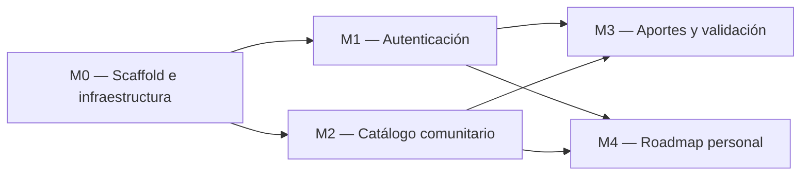

# Implementation Plan — Aprendamos

> **Qué es:** el orden de construcción. Módulos, dependencias, tareas con su definición de hecho
> y estimaciones. Es lo que ejecutás en la Instancia B, tarea por tarea, rama por rama.
> **Cuándo está bien:** cada tarea tiene un "hecho" verificable sin interpretaciones; el orden
> respeta dependencias reales; el MVP está definido sin ambigüedades — se puede responder
> con un sí o un no a la pregunta "¿el lunes a la noche funciona esto?".

## 1. MVP — qué es P0

> Criterio de MVP: en una máquina limpia, `docker compose up` y recorrer end-to-end las
> siguientes historias del PRD, sin errores en consola:

US-001: consultar el catálogo comunitario paginado sin iniciar sesión.
US-002: aportar un curso con sus metadatos.
US-003: aprobar o rechazar los cursos aportados como administrador.
US-004: crear y gestionar un roadmap personal, agregando cursos y organizándolos en el orden elegido.
US-005: registrarse e iniciar sesión.
US-006: recuperar la contraseña mediante un token válido.

## 2. Módulos y dependencias

Las dependencias entre módulos responden a los siguientes requisitos:

- **M0 → M1 y M2:** la autenticación y el catálogo necesitan la infraestructura base, el backend y la base de datos.
- **M1 → M3:** para enviar aportes y realizar las acciones correspondientes, el usuario debe tener una sesión; la validación requiere además permisos de administrador.
- **M2 → M3:** la aprobación de un aporte genera un curso que se incorpora al catálogo público.
- **M1 y M2 → M4:** el roadmap requiere un usuario autenticado y cursos publicados en el catálogo.

> [Ajustá el grafo a tu PRD y tu TRD. Las flechas son dependencias reales:
> no podés probar el catálogo sin el scaffold, no podés aportar sin sesión, etc.]

## 3. Detalle por módulo

### M0 — Scaffold e infraestructura

| # | Tarea | Hecho cuando… | Estimación |
|---|-------|----------------|------------|
| 0.1 | Crear la estructura de carpetas definida en el TRD §3.2 | Existen en el repositorio las carpetas y los archivos base previstos en el TRD | 30 min |
| 0.2 | Configurar `docker-compose.yml` con PostgreSQL 18.6 | `docker compose up postgres` inicia la base de datos y esta acepta conexiones | 45 min |
| 0.3 | Crear el backend mínimo con FastAPI y `GET /health` | `curl localhost:8000/health` devuelve HTTP 200 | 1 h |
| 0.4 | Crear el frontend con React y Vite, con shell y router | El frontend inicia y permite navegar por las rutas iniciales | 1 h |

### M1 — Autenticación

| # | Tarea | Hecho cuando… | Estimación |
|---|-------|----------------|------------|
| 1.1 | Implementar el registro de usuarios | Un usuario puede registrarse con email, contraseña y nombre; el sistema rechaza un email duplicado | |
| 1.2 | Implementar el inicio y cierre de sesión | Las credenciales válidas permiten iniciar sesión y cerrar la sesión invalida el acceso autenticado | |
| 1.3 | Implementar la recuperación de contraseña | Se puede solicitar la recuperación y establecer una nueva contraseña con un token válido; un token inválido o vencido no permite cambiarla | |
| 1.4 | Implementar las pantallas de autenticación | Las pantallas de registro, inicio de sesión y recuperación permiten completar sus flujos y muestran los errores correspondientes | |
| 1.5 | Aplicar las medidas de seguridad de autenticación | Las contraseñas se almacenan mediante bcrypt como mínimo y el endpoint de inicio de sesión limita la frecuencia de intentos | |

### M2 — Catálogo comunitario

| # | Tarea | Hecho cuando… | Estimación |
|---|-------|----------------|------------|
| 2.1 | Cargar categorías y cursos de prueba | Al iniciar el entorno, existen categorías y cursos de prueba disponibles en la base de datos | |
| 2.2 | Implementar `GET /api/v1/cursos` con paginación | La API devuelve únicamente cursos publicados y permite paginar los resultados según los parámetros definidos en el esquema de la API | |
| 2.3 | Implementar la pantalla del catálogo | Se muestran los cursos publicados, la paginación y los mensajes correspondientes cuando no hay resultados o se produce un error | |
| 2.4 | Implementar el detalle de un curso | Se puede consultar un curso publicado por su identificador; si no existe, la API devuelve HTTP 404 | |

### M3 — Aportes y ciclo de validación

| # | Tarea | Hecho cuando… | Estimación |
|---|---|---|---|
| 3.1 | Implementar el envío de aportes | Un usuario autenticado puede enviar un aporte con los campos obligatorios y este queda en estado `en_revision` | |
| 3.2 | Implementar la consulta de aportes pendientes | Un administrador puede consultar los aportes pendientes y un usuario sin permisos de administrador no puede acceder a esa consulta | |
| 3.3 | Implementar la aprobación y el rechazo de aportes | Al aprobar un aporte, se crea el curso correspondiente y se actualiza el estado del aporte dentro de una misma transacción; al rechazarlo, se registra el motivo del rechazo y el curso no se publica | |
| 3.4 | Implementar las pantallas de aporte y validación | El usuario puede completar y enviar el formulario de aporte, y el administrador puede revisar, aprobar o rechazar los aportes | |

### M4 — Roadmap personal

| # | Tarea | Hecho cuando… | Estimación |
|---|---|---|---|
| 4.1 | Implementar la consulta y gestión del roadmap personal | Un usuario autenticado puede consultar su roadmap y agregar cursos publicados | |
| 4.2 | Implementar el orden de los cursos | El usuario puede establecer y modificar el orden de los cursos de su roadmap | |
| 4.3 | Implementar el seguimiento del progreso | El usuario puede marcar un curso como completado y consultar su estado actualizado | |
| 4.4 | Implementar la pantalla del roadmap | Se muestran los cursos ordenados, su estado de finalización y las acciones disponibles para gestionarlos | |

## 4. Ejecución (Instancia B)

> **Regla:** 1 tarea (o lote coherente) = rama según tu flujo documentado + Commits convencionales.
> Actualizá esta tabla mientras avanzás.

| # | Tarea | Módulo | Estado | Rama / Commit |
|---|-------|--------|--------|---------------|
| 0.1 | Estructura de carpetas | M0 | [ ] | |
| 0.2 | docker-compose postgres | M0 | [ ] | |
| … | | | | |

## 5. Estrategia de testing

> Se **planificá** acá y se **implementa** en la clase del 27/10.

- **Unit tests (services):** funciones puras de negocio — ej. reglas de validación de aportes,
  reglas del roadmap, transiciones de estado del curso. Patrón AAA, sin BD ni HTTP.
- **Integration tests (repositories/services):** contra BD real (SQLite en memoria o Postgres del compose).
- **Frontend:** hooks con Vitest (estado de carga, paginación, errores).
- Objetivo de cobertura: [declará el tuyo — ej. ≥ 85% en services]

## 6. Riesgos del plan

| Riesgo | Impacto | Mitigación |
|--------|---------|------------|
| [ej. el formulario de aporte tiene 12 campos: validarlos todo bien lleva más de lo estimado] | | [ej. modelar schema de validación único compartido] |
| | | |

---

**Referencias:**
- Atlassian — Plantilla de plan de proyecto: https://www.atlassian.com/software/confluence/templates/project-plan
- Shape Up — cómo partir trabajo real en scopes cerrables: https://basecamp.com/shapeup/
